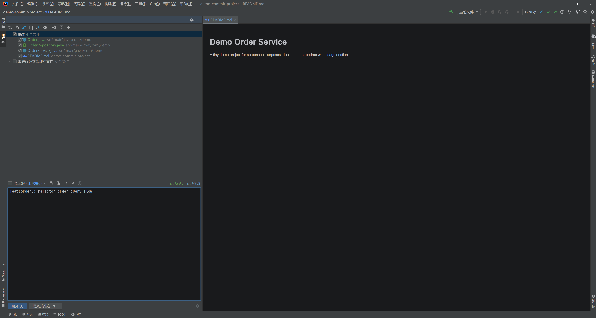
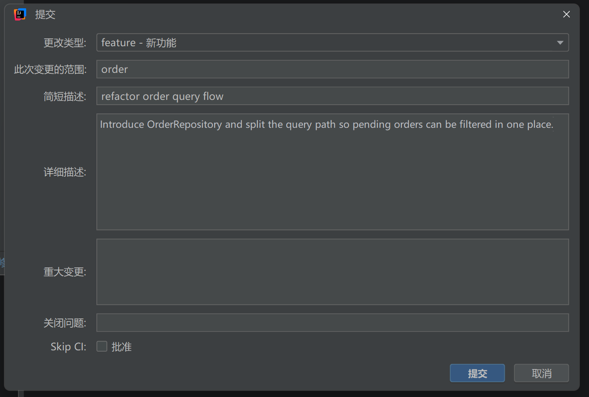
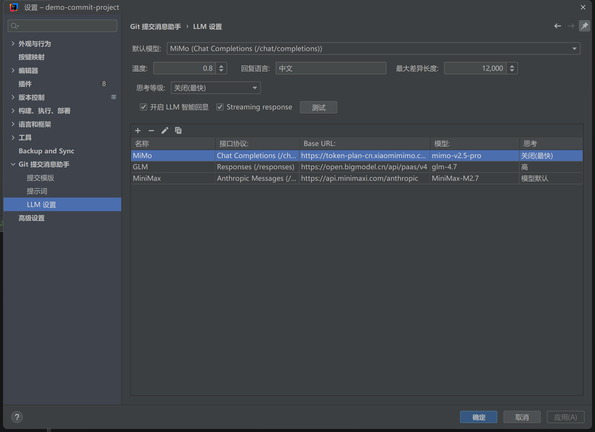

# Git Commit Message Helper

[English](./README.md) | [简体中文](./README.zh-CN.md)

Git Commit Message Helper is an IntelliJ Platform plugin for writing cleaner, more consistent commit messages without leaving the IDE. It combines a structured commit editor, customizable Conventional Commit templates (powered by Apache Velocity), and LLM assistance that speaks your gateway's protocol.



## Installation

Install from the [JetBrains Marketplace](https://plugins.jetbrains.com/plugin/13477-git-commit-message-helper):

`File` → `Settings` → `Plugins` → `Marketplace` → `Git Commit Message Helper`

## Commit Panel Actions

The plugin adds four actions to the VCS commit message area. Each one can be shown or hidden in the plugin settings.

| Action | What it does |
| --- | --- |
| `Generate Commit Message` | Generates a message from the selected changes via LLM. |
| `Generate Commit Message With Additional Context` | Adds per-request requirements first — closed issues, skip-CI notes, bug descriptions — then generates. |
| `Format Commit Message` | Rewrites the current draft to match the configured template. |
| `Create Commit Message` | Opens the structured editor for manual composition. |



## Configuration

Open `File` → `Settings` → `Git 提交消息助手` (Git Commit Message Helper). Everything is configurable:

- Commit template (Apache Velocity), multiple templates with global/project defaults
- Allowed commit types and their descriptions
- Type display style, hidden fields, and skip-CI presets
- Reusable prompt profiles with global and project defaults
- Four commit action visibility toggles

## LLM Compatibility

Each model profile picks one of three API formats, so one base URL works with whatever protocol your gateway speaks:

| API format | Endpoint | Notes |
| --- | --- | --- |
| `Chat Completions` | `/chat/completions` | OpenAI-compatible endpoints (OpenAI, DeepSeek, Qwen, Moonshot, MiniMax, ...) |
| `OpenAI Responses` | `/responses` | OpenAI Responses API and compatible gateways |
| `Anthropic Messages` | `/v1/messages` | Claude and Anthropic-compatible gateways |

The `Base URL` can be a full endpoint or a server base such as `https://api.openai.com/v1` — the plugin appends the matching path automatically.

Every profile has its own **thinking level** and **parameter preset**. Presets include automatic compatibility, model default, `reasoning_effort`, `reasoning.effort`, `thinking.type`, `enable_thinking`, Anthropic token budgets, adaptive thinking, and custom JSON mappings. Only mapped levels appear in the selector; new profiles default to the model's own behavior and send no reasoning parameter. Automatic compatibility preserves existing profile behavior. If a provider explicitly rejects a reasoning parameter, the plugin retries without that parameter and caches the result; unrelated parameter errors do not remove the reasoning configuration.

For custom gateways, choose a preset and configure the mapping for the exact model and protocol. Mappings do not automatically discover upstream capabilities. The Anthropic budget preset supports the `$thinking_budget` placeholder and validates it against the configured response token limit.

For always-on reasoning models, Model default preserves their native behavior; it does not mean thinking is off. A custom mapping containing only `ENABLED` exposes no Off or graded choices. See [thinking configuration examples](doc/llm-thinking.md) for MiniMax M3 / M3.1 Flash and protocol-specific defaults.



**Smart Echo**: when the commit panel already contains text, the structured editor can ask the LLM to parse it back into fields (`type`, `scope`, `subject`, `body`, `changes`, `closes`, `skipCi`) so you can refine the draft instead of starting over.

## Development

- Java 11, Gradle IntelliJ Plugin, targets IntelliJ Platform `2024.1+`

```bash
./gradlew buildPlugin
```

## License

Licensed under the [Apache License 2.0](http://www.apache.org/licenses/LICENSE-2.0).

## Credits

- [git-commit-template](https://github.com/MobileTribe/commit-template-idea-plugin)
- [CodeMaker](https://github.com/x-hansong/CodeMaker)
- [leetcode-editor](https://github.com/shuzijun/leetcode-editor)
